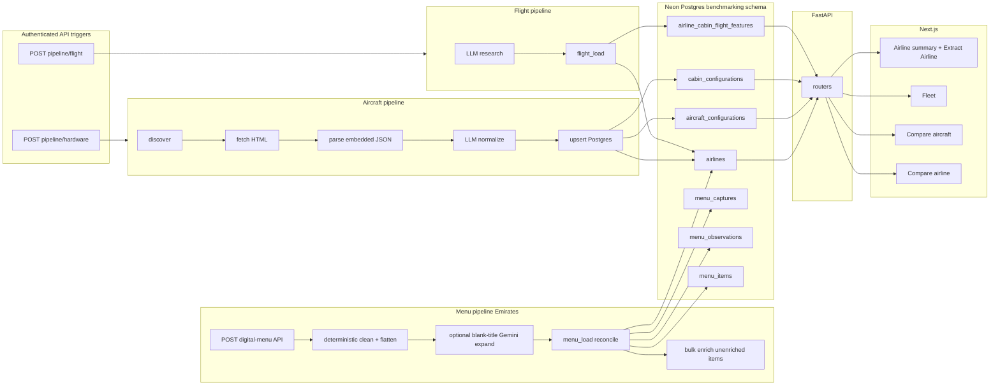
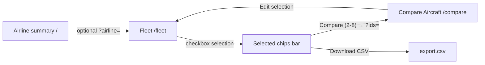

# Flight Benchmarking — Architecture

## Overview

Monolithic repo with three layers:

1. **Pipeline** (`pipeline/`) — discovers and extracts aircraft hardware features from [AeroLOPA](https://www.aerolopa.com/) (core airlines `ek`, `ba`, `ai`; any AeroLOPA slug via CLI or UI) via embedded JSON + LLM normalization; cabin flight features via grounded LLM research; Emirates F&B onboard menus via digital-menu API → deterministic clean/flatten → optional blank-title Gemini expansion → DB load → bulk Gemini enrichment of unenriched items
2. **Backend** (`backend/`) — FastAPI REST API serving aggregated data from Postgres
3. **Frontend** (`frontend/`) — Next.js + shadcn/ui comparison dashboard

**In scope (Phase 1):** Aircraft hardware features (pipeline + DB + API + fleet/compare UI).

**In scope (Phase 2):** Cabin-class *flight* features (baggage, lounge, amenities) at airline × cabin level — LLM research pipeline, DB tables, API extensions, aircraft detail flight panel, **Airline Cabin Comparison** UI with column editing, and **web-triggered pipeline runs** from View 1 (Extract Airline).

**In scope (Phase 3 — pipeline + read UI):** Emirates F&B onboard menu extraction (`date` × `flight` × `origin` × `destination` × cabin) — digital-menu API fetch, deterministic HTML cleaning + flatten of category/subcategory/code/title/desc, optional Gemini expansion for blank-title descriptions, reconcile/load to menu tables, then bulk Gemini enrichment (food/beverage, dietary, non-DXB localization) for rows with `enriched_at IS NULL`. **Menu read API + Menu Analysis frontend** compare observations across flights; pipeline API trigger still deferred.

See [Key design decisions](#key-design-decisions) for rationale behind major choices. Update that section and the [Change log](#change-log) when scope, stack, or architecture changes.

## Monorepo layout

```
flight-benchmarking/
├── backend/
│   ├── app/
│   │   ├── main.py              # FastAPI entry (routes + auth)
│   │   ├── config.py            # env, CORS, edit auth
│   │   ├── auth.py              # single-password edit auth (HMAC session tokens)
│   │   ├── db/                  # SQLAlchemy engine, session, Neon URL normalization
│   │   ├── models/              # ORM models
│   │   └── routers/             # airlines, aircraft, compare, flight_features, menu, export, pipeline, aircraft_grouping
│   └── alembic/                 # migrations
├── pipeline/
│   ├── config.py                # target airlines, rate limits
│   ├── discover.py              # list config URLs per airline
│   ├── fetch.py                 # HTTP fetch + HTML storage
│   ├── parse_json.py            # extract embedded Next.js aircraft JSON
│   ├── deck.py                  # dual-deck detection (-m/-u suffixes, parent skip)
│   ├── clean.py                 # pre-LLM payload stripping
│   ├── normalize.py             # deterministic base + LLM deep-merge
│   ├── validate.py              # field-level tolerant LLM validation
│   ├── artifacts.py             # save data/parsed JSON artifacts
│   ├── flight_research.py       # Gemini + Google Search grounding for flight benefits
│   ├── flight_load.py           # upsert flight_feature_sources + airline_cabin_flight_features
│   ├── menu_config.py           # Emirates onboard-menu URL template + cabin codes + MENU_LLM_MODEL
│   ├── menu_fetch.py            # POST digital-menu API + JSON evidence snapshots
│   ├── menu_extract.py          # deterministic clean/flatten + optional blank-title expansion
│   ├── menu_load.py             # reconcile upsert menu_captures / observations / items (preserve enrichment)
│   ├── menu_enrich.py           # bulk Gemini enrichment for unenriched menu_items
│   ├── menu_artifacts.py        # save data/parsed/menu artifacts
│   ├── load.py                  # upsert aircraft; get_or_create_airline (name preservation)
│   ├── prompts/                 # EPD-style LLM prompts + typed output schema
│   ├── run.py                   # aircraft CLI + execute_hardware_pipeline (API-shared)
│   ├── run_flight.py            # flight CLI + execute_flight_pipeline (API-shared)
│   ├── run_menu.py              # Emirates menu CLI + execute_menu_pipeline
│   └── run_progress.py          # flush_run_progress — mid-run DB commits for UI polling
├── frontend/                    # Next.js 14+ App Router + shadcn/ui
│   ├── app/
│   │   ├── page.tsx             # View 1: airline fleet summary (server shell + AirlineDashboard)
│   │   ├── fleet/               # View 2: fleet table + selection/export + infinite scroll
│   │   ├── compare/             # View 3: aircraft side-by-side comparison + edit
│   │   │   └── airlines/        # View 4: airline cabin comparison + edit
│   │   ├── menu/                # View 5: menu items analysis / comparison
│   │   └── aircraft/[svg_id]/   # Aircraft detail (hardware + flight features)
│   ├── components/
│   │   ├── ui/                  # shadcn primitives (table, card, badge, dialog, etc.)
│   │   ├── airline-dashboard.tsx       # View 1 client: Extract Airline + Airlines table
│   │   ├── airline-extract-section.tsx # comma-separated slug input + extract/update triggers
│   │   ├── airline-summary-table.tsx   # airlines metrics table (read-only)
│   │   ├── pipeline-progress-panel.tsx # live extraction progress (status, bar, errors)
│   │   ├── pipeline-trigger-button.tsx # authenticated pipeline run trigger
│   │   ├── sign-in-dialog.tsx          # shared edit-auth dialog
│   │   ├── multi-select-filter.tsx
│   │   ├── menu-flight-selector.tsx  # menu analysis flight×date multi-select
│   │   ├── airline-compare-selector.tsx  # chip-based airline picker (URL-synced)
│   │   ├── compare-column-editor.tsx     # aircraft compare edit cells
│   │   ├── flight-compare-cell.tsx       # airline compare edit cells
│   │   └── ...                  # PageHeader, MetricCard, AppShell, AirlineBadge, etc.
│   ├── lib/
│   │   ├── api.ts               # typed fetch client + auth + pipeline triggers + CSV download + menu
│   │   ├── use-edit-auth.ts     # compare edit session hook (aircraft + airline)
│   │   ├── use-pipeline-run.ts    # pipeline run polling (used via PipelineRunProvider)
│   │   ├── pipeline-run-context.tsx # shared active-run state for trigger buttons + progress panel
│   │   ├── airline-slugs.ts       # parse/validate comma-separated AeroLOPA slugs
│   │   ├── compare-fields.ts    # aircraft field types/labels (mirrors shared/compare_fields.py)
│   │   ├── flight-fields.ts     # flight field types/labels (mirrors shared/flight_fields.py)
│   │   ├── menu-fields.ts       # menu summary metric labels + flight label helpers
│   │   ├── constants.ts         # MIN/MAX compare limits, FLEET_PAGE_SIZE
│   │   └── design-tokens.ts     # table density, cabin keys, compare column classes
│   └── components.json          # shadcn config
├── tests/                       # API, compare, export, flight update, pipeline trigger, menu API, airline upsert tests
├── scripts/                     # reset_schema, deck migration, verification helpers
├── docs/
│   ├── architecture.md
│   ├── deployment.md
│   └── food_beverage_menu.md  # F&B menu extraction schema + airline source notes
├── shared/
│   ├── schemas.py               # Pydantic models (pipeline + backend contract)
│   ├── compare_fields.py        # aircraft compare/edit field metadata + coercion
│   ├── flight_fields.py         # airline flight compare/edit field metadata + coercion
│   └── constants.py             # MAX_COMPARE_CONFIGS (8)
├── output.py                    # kept as reference example
├── pyproject.toml               # Poetry deps for backend + pipeline
├── .env.example
└── readme.md
```

Deploy targets: `frontend/` → Vercel, backend API → Railway (root [`railway.toml`](../railway.toml) + [`nixpacks.toml`](../nixpacks.toml)).

## Data flow



**Incremental updates:** Store `last_updated` (from AeroLOPA JSON) and `fetched_at` per config. By default, re-runs extract and upsert all discovered configs (refreshing existing DB rows). Use `--skip-existing` to skip fetch/parse/LLM for configs already in the database and only backfill net-new `svg_id`s.

## Data pipeline

| Stage | Module | Description |
|-------|--------|-------------|
| Discover | `pipeline/discover.py` | List config URLs per airline slug on AeroLOPA (e.g. `/ek`, `/ba`, `/ai`, or any slug such as `/cx`) |
| Fetch | `pipeline/fetch.py` | Download HTML to `data/raw/{svg_id}.html` |
| Parse | `pipeline/parse_json.py` | Extract embedded Next.js aircraft JSON |
| Normalize | `pipeline/normalize.py` | Deterministic base + Langchain/Gemini deep-merge |
| Load | `pipeline/load.py` | Upsert into `benchmarking.*` tables |
| Artifacts | `pipeline/artifacts.py` | Save raw/normalized JSON to `data/parsed/` |
| Deck | `pipeline/deck.py` | Detect `-m`/`-u` deck pages; skip dual-deck parent overview rows at load |

### Dual-deck aircraft

AeroLOPA dual-deck types (e.g. A380) expose a parent overview page plus per-deck pages (`ek-388j-m`, `ek-388j-u`).

| Layer | Behaviour |
|-------|-----------|
| Pipeline | `is_dual_deck_parent()` skips upserting the parent overview; deck pages (`-m`, `-u`) are canonical DB rows with `parent_svg_id`, `deck`, `deck_state`, and optional `decks` JSONB |
| API list/detail | `aircraft_grouping.py` merges rows sharing a `parent_svg_id` into one logical config (`svg_id` = group id); seat counts and cabins are merged across decks |
| Fleet UI | Combined row shows **Dual deck** badge; `source_url` points at parent group URL when merged |
| Compare/edit | Operates on grouped `svg_id`; cabin updates route to the deck row with the most seats for that cabin |

### Pipeline troubleshooting

**Run summary counts:**

| Log term | Meaning |
|----------|---------|
| `updated` | Config extracted and upserted to Postgres |
| `skipped (already loaded)` | Config already in DB and skipped via `--skip-existing` |
| `skipped_parent` | Dual-deck parent overview — artifacts saved, DB load skipped (deck pages are canonical) |
| `errors` | Fetch, parse, or unhandled failure |

Per-config lines look like: `INFO ek-359g: updated (source=llm)` or `INFO ek-359u: skipped (already loaded)`.

**Flags:**

- `--limit N` — process only the first N discovered configs (useful for dev)
- `--skip-existing` — skip fetch/parse/normalize for configs already in the database; only process net-new `svg_id`s
- `--force` — re-fetch HTML from AeroLOPA (bypass `data/raw/` cache); overrides `--skip-existing`

**Artifact directories:**

| Path | Content |
|------|---------|
| `data/raw/{svg_id}.html` | Cached AeroLOPA HTML |
| `data/parsed/{svg_id}.raw.json` | Extracted embedded aircraft JSON (full parse, includes per-seat map) |
| `data/parsed/{svg_id}.cleaned.json` | Pre-LLM payload: seats/URLs/assets stripped via `pipeline/clean.py` |
| `data/parsed/{svg_id}.normalized.json` | Final schema after normalize (deterministic + optional LLM merge) |
| `data/parsed/{svg_id}.llm.json` | Raw parsed JSON from LLM (when source=llm) |
| `data/parsed/{svg_id}.meta.json` | `{ "source", "normalized_at", "last_updated", "dropped_fields" }` |

If DB rows look sparse, inspect `data/parsed/*.normalized.json` first. Normalization builds a deterministic base from raw JSON, then deep-merges LLM output (non-null overlay values only). Field-level tolerant validation drops invalid LLM fields back to the deterministic base rather than failing the whole record. If LLM fails entirely, deterministic output is used.

### Discovery (`pipeline/discover.py`)

- For each slug (`ek`, `ba`, `ai`, or any AeroLOPA slug such as `cx`): `GET https://www.aerolopa.com/{slug}`
- Extract config URLs from `href="/{slug}-..."` links; for dual-deck types, also parse `aircraft_code` from embedded RSC JSON to catch `-m`/`-u` deck pages
- Persist discovered URLs in `pipeline_runs` / `source_pages` tracking table

### Fetch (`pipeline/fetch.py`)

- Polite HTTP client (User-Agent, small delay between requests)
- Save raw HTML to `data/raw/{svg_id}.html` for audit/replay
- Record HTTP status and fetch timestamp

### JSON parse (`pipeline/parse_json.py`)

- Extract `self.__next_f.push(...)` payloads from HTML
- Collect candidate aircraft objects and return the richest (most cabin fields)
- Return structured dict; fail gracefully with logged error if parse fails

### LLM normalize (`pipeline/normalize.py`, `pipeline/clean.py`, `pipeline/prompts/`, `pipeline/validate.py`)

- Build deterministic base from **full** raw JSON (IFE/WiFi split, USB, recline, seat ratings from `seats` map, etc.)
- **Pre-LLM clean** (`pipeline/clean.py`): strip `seats`, image URLs, and asset noise before prompt injection (~168KB → ~3KB for typical configs)
- EPD-style structured prompt in `pipeline/prompts/aircraft_hardware_prompt.py` (role, context, field definitions, constraints, full `ek-359g` example from `output.py`)
- **Typed output schema** in `pipeline/prompts/schema_format.py` — generated from `shared/schemas.py` Pydantic models (EPD-style `<string>`, `<integer>`, nested objects)
- Langchain/Gemini deep-merges over base — LLM cannot wipe deterministic fields with nulls
- Field-level tolerant validation in `pipeline/validate.py` — invalid LLM fields fall back to base values; `dropped_fields` recorded in meta
- Configurable model via env (`LLM_MODEL=gemini-2.5-pro`)

### Load (`pipeline/load.py`)

- Upsert airlines, aircraft configurations, cabin rows
- Use `svg_id` as natural key (e.g. `ek-359g`)
- **`get_or_create_airline` name preservation:** when the flight pipeline passes a code-like display name (uppercase slug or IATA code, e.g. `"CX"` for Cathay Pacific), an existing human-readable `airlines.name` from the aircraft pipeline is **not** overwritten. Aircraft loads with proper `airline_name` from AeroLOPA/LLM remain stable after `run_flight`. New airlines still get the incoming name on first insert. See `tests/test_airline_upsert.py`.

### CLI (`pipeline/run.py`)

Core orchestration lives in `execute_hardware_pipeline(db, run_record, airlines, ...)` — shared by the CLI and `POST /api/v1/pipeline/hardware`. The CLI creates a `PipelineRun` row and calls execute; the API pre-creates the row and runs execute in a background thread.

**Live progress (API runs):** after discovery sets `configs_discovered`, and after each config is processed (update, skip, or error), `execute_hardware_pipeline` calls `flush_run_progress()` from `pipeline/run_progress.py` to commit counters on `pipeline_runs`. The UI polls `GET /api/v1/pipeline/runs/{run_id}` every 2.5s and renders incremental progress.

```bash
# From repo root (with .env configured)
poetry install
python -m pipeline.run --airlines ek,ba,ai
python -m pipeline.run --airlines cx              # any AeroLOPA slug
python -m pipeline.run --airlines ek --limit 5 --skip-existing   # backfill only net-new configs
python -m pipeline.run --airlines ek --limit 5 --force           # dev: re-fetch from AeroLOPA
```

### Flight features pipeline (`pipeline/run_flight.py`)

Core orchestration lives in `execute_flight_pipeline(db, run_record, airlines, ...)` — shared by the CLI and `POST /api/v1/pipeline/flight`.

**Live progress (API runs):** sets `configs_discovered = len(airlines)` at start, then flushes after each airline is processed (update, skip, or error) via `flush_run_progress()`. Progress units in the UI are **airlines** (not configs).

| Stage | Module | Description |
|-------|--------|-------------|
| Research | `pipeline/flight_research.py` | Gemini + Google Search grounding; EPD prompt (`flight_features_research_prompt.py`); ≥5 credible sources per cabin |
| Load | `pipeline/flight_load.py` | Upsert `flight_feature_sources` + `airline_cabin_flight_features` |

**Research flow:** A single grounded LLM call searches the web per airline, collects credible sources per cabin class, and returns JSON matching `output.py` (`features` nested per cabin + `sources` arrays). Artifacts land in `data/parsed/flight/{slug}.llm.json` and `.meta.json` (model, researched_at, sources_by_cabin, grounding queries).

```bash
python -m pipeline.run_flight --airlines ek,ba,ai
python -m pipeline.run_flight --airlines cx       # any AeroLOPA slug
python -m pipeline.run_flight --airlines ek --force         # re-run LLM research
python -m pipeline.run_flight --airlines ek --skip-existing # skip airlines already in DB
```

Requires `GOOGLE_API_KEY` and `LLM_MODEL` (default `gemini-2.5-pro`). Google Search grounding is billed per prompt on Gemini 2.5. Set `GOOGLE_API_KEY` on Railway when using the flight pipeline trigger from the UI.

### Menu pipeline — Emirates F&B (`pipeline/run_menu.py`)

Core orchestration lives in `execute_menu_pipeline(db, run_record, service_date=..., flight=..., origin=..., destination=..., cabins=..., force=..., skip_existing=...)` — CLI now; API trigger deferred to a later phase.

**Live progress:** sets `configs_discovered = len(cabins)` at start, then flushes after each cabin (update, skip, or error) via `flush_run_progress()`. Progress units are **cabins**.

| Stage | Module | Description |
|-------|--------|-------------|
| Fetch | `pipeline/menu_fetch.py` | `POST /service/exp/digital-menu?lang=en` with flight/origin/date/cabin; save JSON evidence under `data/raw/menu/` + `evidence/emirates/` |
| Clean + flatten | `pipeline/menu_extract.py` | Strip HTML/entities/control chars from text; mirror API labels into `category`, `subcategory`, `code`, `title`, `desc` |
| Blank-title expand | `pipeline/menu_extract.py` + `menu_blank_title_prompt.py` | One Gemini call per cabin only when blank-title + desc items exist; split into `BASE_1`… rows; preserve originals on failure |
| Load | `pipeline/menu_load.py` | Reconcile upsert `menu_captures` → `menu_observations` → `menu_items` by `item_hash`; preserve enrichment when base fields unchanged |
| Enrich | `pipeline/menu_enrich.py` + `menu_enrichment_prompt.py` | Query `enriched_at IS NULL`; batch 50; Gemini food/beverage + dietary + non-DXB localization; apply valid partial results; `.enrichment.json` audit |

**Grain:** airline × cabin × route × direction × date. One cabin API response = one capture + one observation + many items. Direction is `outbound` when origin is `DXB`, else `inbound`. Unavailable cabins (empty categories) are skipped, not errored.

**Item fields (API mirror):** `category` ← `categories[].title`; `subcategory` ← `subCategories[].title`; `code` / `title` / `desc` ← cleaned `items[]` fields. Expanded blank titles use `code=BASE_N` and `item_hash=m:BASE_N`.

**Enrichment fields:** `item_type` (`food`\|`beverage`); beverages set `beverage_type`; foods set `is_vegetarian` / `is_vegan` / `is_localized` / `localization_confidence` / `localization_note`; plus `enrichment_version` / `enriched_at`. Flow: `extract/load → query unenriched → bulk Gemini → validated DB update`.

**Source / versioning:** extract `api` / `api+llm` / `api_llm_fallback` as before (`menu_api_transform_v2` + optional blank-title prompt/model). Enrichment writes `menu_enrichment_v1` independently and does not fail the cabin extract on LLM errors.

**Note:** The onboard-menu HTML page is JS-rendered; dish content is **not** in the initial HTML. The pipeline calls the public digital-menu API directly (no Playwright / no login).

Schema reference: [docs/food_beverage_menu.md](./food_beverage_menu.md).

```bash
python -m pipeline.run_menu --date 2026-08-01 --flight 7 --origin DXB --destination LHR
python -m pipeline.run_menu --date 2026-08-01 --flight 7 --origin DXB --destination LHR --cabins business,economy
python -m pipeline.run_menu --date 2026-08-01 --flight 7 --origin DXB --destination LHR --force
python -m pipeline.run_menu --date 2026-08-01 --flight 7 --origin DXB --destination LHR --skip-existing
```

Requires `DATABASE_URL`. Blank-title expansion and enrichment use `GOOGLE_API_KEY` + `MENU_LLM_MODEL` (default `gemini-3.5-flash`); without a key, blank-title rows are kept as-is and enrichment leaves rows unenriched for a later retry. Hardware/flight pipelines still use `LLM_MODEL`.

### Web-triggered pipelines (`backend/app/routers/pipeline.py`)


Signed-in users (same `require_edit_auth` as compare PATCH) can start pipelines from the **Extract Airline** section on View 1. Runs execute in a daemon background thread; the client polls `GET /api/v1/pipeline/runs/{run_id}` (or `/active` on page load) every 2.5s via `usePipelineRun`.

| Behaviour | Detail |
|-----------|--------|
| Concurrency | `409` if any `pipeline_runs` row has `finished_at IS NULL` |
| Request body | `PipelineTriggerRequest`: `{ airlines: string[], force?: bool, skip_existing?: bool }` — accepts multiple slugs in one request |
| Response | `202` + `PipelineRunResponse` (`status`: `running` \| `completed` \| `failed`) |
| Audit | Same `pipeline_runs` table as CLI; `pipeline_type` = `hardware` \| `flight` |
| Mid-run progress | `execute_*_pipeline` commits `configs_discovered`, `configs_updated`, `configs_skipped`, and `errors` incrementally via `pipeline/run_progress.flush_run_progress` so poll responses reflect live extraction progress |

**Extract vs update (UI):** **Extract** buttons send `skip_existing: false` (new airline or full re-run). **Update** buttons send `skip_existing: true` (incremental backfill for configs/airlines already in DB). Both use the same comma-separated AeroLOPA slug input — no table row selection.

**Progress semantics** (`PipelineRunResponse` counts):

| Pipeline | `configs_discovered` | Progress unit in UI | `processed` |
|----------|----------------------|---------------------|-------------|
| Hardware | Total configs discovered across all slugs | configs | `configs_updated + configs_skipped` |
| Flight | `len(airlines)` | airlines | `configs_updated + configs_skipped` |

While hardware discovery is in progress, `configs_discovered` may be `0`; the UI shows **Discovering…** until the total is flushed.

## Database schema

Schema: `benchmarking` in Neon Postgres (database name from your Neon project, e.g. `neondb`).

| Table | Purpose | Key columns |
|-------|---------|-------------|
| `airlines` | Airline metadata | `id` UUID PK, `slug`, `iata_code`, `name` |
| `aircraft_configurations` | Aircraft-level features | `id` UUID PK, `svg_id` unique, `airline_id` UUID FK, `source_url`, `aircraft_type`, `configuration`, dual-deck cols (`is_dual_deck`, `deck`, `parent_svg_id`, `deck_state`, `decks` JSONB), `seat_counts` JSONB, `wifi` JSONB, `ife_*`, `last_updated`, `fetched_at`, `updated_at` |
| `cabin_configurations` | Cabin-level features | `id` UUID PK, `aircraft_id` UUID FK, `deck`, `cabin_key` (unique per aircraft+deck), pitch/width/recline, USB, power, `layout`, seat fields |
| `pipeline_runs` | Audit trail + live run progress | `id` UUID PK, `pipeline_type` (`hardware` \| `flight`), `started_at`, `finished_at`, `airlines` JSONB, `configs_discovered`, `configs_updated`, `configs_skipped`, `errors` JSONB — counters updated incrementally during API-triggered runs |
| `flight_feature_sources` | Curated/discovered airline product page URLs | `airline_id` FK, `url`, `source_type`, `page_type`, `cabin_keys` JSONB, `title`, `http_status`, `fetched_at` |
| `airline_cabin_flight_features` | Airline × cabin flight benefits | `airline_id` + `cabin_key` unique, typed baggage/priority/lounge/amenity cols, `source_url` (primary research reference), `extra_features` JSONB |
| `menu_captures` | Emirates digital-menu API fetch audit | unique on (`flight_number`,`origin_iata`,`dest_iata`,`service_date`,`cabin_code`); `source_url`, `snapshot_path`, `media_type` (`application/json`), `http_status`, `raw_bytes_size`, `default_tier` |
| `menu_observations` | One observation per capture (cabin × route × date) | `capture_id` unique FK, `cabin_norm`, `direction`, `menu_cycle`, `grain_observed` JSONB, `extractor_version`, `extracted_at` |
| `menu_items` | Dish/drink rows under an observation | unique on (`observation_id`,`item_hash`); `category`, `subcategory`, `code`, `title`, `desc`, `position`; enrichment: `item_type`, `beverage_type`, `is_vegetarian`, `is_vegan`, `is_localized`, `localization_confidence`, `localization_note`, `enrichment_version`, `enriched_at` |

- All primary keys and foreign keys use UUID (`uuid4` on insert)
- `source_url` on `aircraft_configurations` stores the AeroLOPA page URL (`https://www.aerolopa.com/{svg_id}`), set at aircraft pipeline load
- `source_url` on `airline_cabin_flight_features` stores the primary research reference URL for that airline × cabin row (from flight pipeline or manual PATCH)
- `svg_id` remains the business/natural key for API routes and compare UI
- Schema reset after UUID migration: `poetry run python scripts/reset_schema.py` then re-run pipeline

## API

**Dependencies:** FastAPI, SQLAlchemy 2.x, asyncpg/psycopg, Pydantic v2, uvicorn

Base URL: `http://localhost:8000`

| Endpoint | View | Returns |
|----------|------|---------|
| `GET /health` | — | Health check |
| `POST /api/v1/auth/login` | Edit auth + pipeline | `{ token }` — HMAC-signed session token (8h TTL); 503 if `EDIT_PASSWORD` unset |
| `GET /api/v1/auth/me` | Edit auth + pipeline | `{ authenticated }` — validates Bearer token; returns `authenticated: true` when edit auth disabled |
| `POST /api/v1/auth/logout` | Edit auth + pipeline | No-op server-side; client clears token |
| `GET /api/v1/airlines/summary` | Summary | Per-airline: fleet count, haul/manufacturer breakdown, aircraft types, last pipeline update |
| `GET /api/v1/aircraft` | Fleet detail | Grouped list (dual-deck merged); query params: `airline` and `aircraft_type` (comma-separated multi-value), `haul_type`, `manufacturer`, `search`, `has_premium_economy=true`, `offset`, `limit` |
| `GET /api/v1/aircraft/filter-options` | Fleet filters | Canonical `haul_types` and distinct `manufacturers` for Fleet multi-select filters |
| `GET /api/v1/aircraft/{svg_id}` | Detail drill-down | `AircraftDetailResponse`: grouped aircraft + cabins + `flight_features` |
| `GET /api/v1/compare?ids=ek-359g,ba-19a&cabin=business` | Compare | `CompareResponse`: hardware + flight feature rows (`scope=flight`); 2–8 configs |
| `GET /api/v1/compare/airlines?slugs=ek,ba&cabin=business` | Airline compare | `CompareAirlineResponse`: flight benefits across 2–8 airlines; includes **Reference URL** row (`field_key=source_url`) |
| `PATCH /api/v1/aircraft/{svg_id}` | Aircraft compare edit | Partial update of hardware fields only; returns `AircraftDetailResponse` |
| `PATCH /api/v1/airlines/{slug}/flight-features?cabin=business` | Airline compare edit | Partial update of flight fields + optional `source_url`; returns `CabinFlightFeatures`; same `require_edit_auth` as aircraft PATCH |
| `POST /api/v1/pipeline/hardware` | Pipeline trigger | Start per-airline hardware extraction in background; `require_edit_auth`; body `PipelineTriggerRequest`; returns `202` + `PipelineRunResponse` |
| `POST /api/v1/pipeline/flight` | Pipeline trigger | Start per-airline flight features research in background; same auth/body shape |
| `GET /api/v1/pipeline/runs/{run_id}` | Pipeline status | Poll run progress (counts update incrementally during execution); `require_edit_auth` |
| `GET /api/v1/pipeline/runs/active` | Pipeline status | Current in-progress run or `null` (used to resume progress panel on page load); `require_edit_auth` |
| `GET /api/v1/export.csv?ids=ek-359g,ba-19a` | Fleet export | CSV — one row per cabin per config (hardware fields) |
| `GET /api/v1/menu/filter-options?cabin=business&item_type=all` | Menu Analysis | Distinct cabins + selectable observations (flight×route×date) for the cabin; `item_count` respects `item_type` (`food` / `beverage` / `all`) |
| `GET /api/v1/menu/compare?observation_ids=…&cabin=business&item_type=food` | Menu Analysis | `MenuCompareResponse`: summary + detail matrices for 2–8 observations; unioned category/subcategory rows; metric counts exclude null enrichment |

**Aircraft compare response** (`shared/schemas.py`):

| Field | Type | Purpose |
|-------|------|---------|
| `columns` | `CompareConfigColumn[]` | Per-config header metadata: `svg_id`, `airline_slug`, `airline_name`, `aircraft_type_displayed`, `aircraft_code_displayed`, `configuration`, `source_url` |
| `rows` | `CompareRow[]` | Pivoted features: `feature`, `field_key`, `scope`, `category`, `values` keyed by `svg_id` |

**Airline compare response** (`CompareAirlineResponse`):

| Field | Type | Purpose |
|-------|------|---------|
| `columns` | `CompareAirlineColumn[]` | Per-airline header: `slug`, `name`, `iata_code` |
| `rows` | `CompareRow[]` | Pivoted flight features (`scope=flight`) plus **Reference URL** row; `values` keyed by airline `slug` |

**Airline compare PATCH body** (`AirlineFlightFeaturesUpdate`):

| Field | Type | Purpose |
|-------|------|---------|
| `fields` | `dict[str, Any]` | Dirty flight field keys from `shared/flight_fields.FLIGHT_FIELDS` |
| `source_url` | `str \| null` | Optional reference URL update (explicit presence detected via `model_fields_set`) |

Field coercion: `shared/flight_fields.coerce_flight_field_value` (string/int/list; `amenity_kit` accepts comma-separated or JSON array).

**Menu compare response** (`MenuCompareResponse`):

| Field | Type | Purpose |
|-------|------|---------|
| `columns` | `MenuCompareColumn[]` | Per-observation header: flight, route, date, cabin, `available`, `item_count` |
| `summary_rows` | `MenuCompareSummaryRow[]` | Category/subcategory rows; `values[observation_id]` → `MenuMetricCounts` (alcoholic, non_alcoholic, vegetarian, vegan, localized; null enrichment excluded) |
| `detail_rows` | `MenuCompareDetailRow[]` | Same grouping; `values[observation_id]` → ordered item list with enrichment flags |
| `cabin` / `item_type` | echo | Global filters applied to the response |

**Pipeline trigger schemas** (`shared/schemas.py`):

| Model | Purpose |
|-------|---------|
| `PipelineTriggerRequest` | `airlines`, optional `force`, `skip_existing` |
| `PipelineRunResponse` | `id`, `pipeline_type`, `status`, timestamps, counts, `errors` |

**Performance choices:**

- Summary endpoint uses SQL aggregations (not N+1)
- Fleet list groups dual-deck rows in Python after a single join query (no N+1 per deck)
- Fleet list paginates grouped results (`offset`/`limit`/`total`); frontend infinite scroll loads pages incrementally
- Compare endpoints return a pre-pivoted structure (`rows`: feature name → values per column) plus `columns` metadata for readable table headers — no client-side reshape or extra detail fetches
- Response schemas are slim DTOs (no raw HTML, no seat-level data in list views)
- CORS configured for local dev, production Vercel origin, and `*.vercel.app` previews via `CORS_ORIGIN_REGEX`

## Frontend

**Stack:** Next.js App Router, TypeScript, Tailwind CSS (via shadcn), shadcn/ui component library, TanStack Table for sortable/filterable data grids.

**Design system (Linear light + LCM Hub layout):**

- **Color palette:** Linear light theme in `frontend/app/globals.css` — canvas `#f7f8f8`, panels `#ffffff`, accent `#5e6ad2`, hairline borders `rgba(0,0,0,0.08)`. Semantic label colors (`--label-red`, `--label-blue`, etc.) for airline badges.
- **Layout inspiration:** [LCM Hub](https://www.lcmhub.com) — section eyebrows, metric-first dashboards, card-contained data panels, consistent page template across views.
- **Typography:** Inter (UI) + Geist Mono (config IDs); compact `text-sm` base, `text-xs` tables.
- **Tokens:** `frontend/lib/design-tokens.ts` — table density classes, control widths, cabin keys, airline label mappings, `COMPARE_AIRLINE_COLUMN_CLASS` / `COMPARE_FEATURE_COLUMN_CLASS` (fixed-width wrapping columns for **both** airline and aircraft compare; requires `table-fixed` on the table)
- **Core shadcn components:** `table`, `card`, `badge`, `button`, `select`, `input`, `checkbox`, `tabs`, `separator`, `skeleton`, `tooltip`, `dialog`
- **App-level composites:** `PageHeader`, `MetricCard`, `SectionCard`, `EmptyState`, `LoadingState`, `TableToolbar`, `AirlineBadge`, `AirlineDashboard`, `AirlineExtractSection`, `PipelineProgressPanel`, `PipelineTriggerButton`, `SignInDialog`, `MultiSelectFilter`, `MenuFlightSelector`, `AirlineCompareSelector`, `CompareValueCell` / `CompareFieldInput`, `FlightCompareValueCell` / `FlightCompareFieldInput`
- **Page template:** `PageHeader` → optional `MetricCard` grid → `SectionCard`(s) with edge-to-edge table; shared empty/loading states
- **Layout shell:** `AppShell` with shadcn `Tabs` (line variant) for **Airline** / **Fleet** / **Compare Aircraft** / **Compare Airline** / **Menu Analysis** navigation; subtitle **Features Comparison**; `PipelineRunProvider` wraps page content for shared pipeline run polling

### View 1 — Airline Fleet Summary (`/`)

Server component renders `PageHeader`, `MetricCard` grid, and client `AirlineDashboard` (`PipelineRunProvider` wraps the app shell).

**Extract Airline** (`SectionCard`):

- Compact toolbar: comma-separated AeroLOPA **slug** input (e.g. `cx, sq, ek`) + four actions when signed in:
  - **Extract hardware** / **Extract flight** — `skip_existing: false` (new airline or full re-run)
  - **Update hardware** / **Update flight** — `skip_existing: true` (incremental)
- Slugs parsed via `frontend/lib/airline-slugs.ts` — split on commas, trim, lowercase, dedupe; validated against `^[a-z0-9-]{2,20}$`; invalid tokens block the buttons with an inline error
- One pipeline request can include multiple slugs (`airlines: string[]` in `PipelineTriggerRequest`)
- **`PipelineProgressPanel`** below the toolbar shows live status: pipeline type, running/completed/failed badge, airline list, progress bar (`processed / total`), error list, and dismiss when finished
- `PipelineTriggerButton` triggers runs only (spinner on active button); status text lives in the progress panel
- `usePipelineRun` polls run status every 2.5s; resumes in-progress runs from `GET /api/v1/pipeline/runs/active` on page load; `clearLastResult()` dismisses completed runs
- Refreshes airline summaries on completion
- **Sign in** when `EDIT_PASSWORD` is set (same token as compare edit)
- Discovery accepts **any** AeroLOPA slug, not only `ek` / `ba` / `ai`

**Airlines** (`SectionCard`):

- Read-only metrics `Table` (no pipeline controls on rows)
- Columns: Airline, Configurations, Long Haul Aircraft, Short Haul Aircraft, Airbus Aircraft, Boeing Aircraft, Other Aircraft, Last Updated (dates formatted `en-GB`, e.g. `30 Jun 2026`)
- Haul/manufacturer counts computed server-side in `airlines.py` from grouped aircraft configs
- Click airline → navigate to Fleet with airline filter pre-applied

### Cross-airline aircraft comparison flow

Fleet is the **primary selection surface** for aircraft compare; Compare Aircraft shows side-by-side hardware results and supports **column-scoped batch editing** (one config per save).



- **URL state:** selection is synced to `?ids=` on Fleet and Compare Aircraft (e.g. `/fleet?ids=ek-359g,ba-19a&airline=all`)
- **Cross-airline discovery:** use airline filter **All airlines** plus aircraft type filter or search (e.g. `A380`) to find like-for-like configs across carriers
- **Limits:** **Compare** 2–8 configs (`MAX_COMPARE_CONFIGS` in `shared/constants.py`; enforced on Compare button and `/api/v1/compare`). **CSV export** has no selection cap — Fleet checkboxes may select any number of configs; `GET /api/v1/export.csv` accepts all selected `svg_id`s (minimum 1).

### View 2 — Fleet detail (`/fleet`)

- `PageHeader` with `TableToolbar` filters in actions slot:
  - **Airline** — `MultiSelectFilter` from `GET /api/v1/airlines/summary` (empty = all airlines; comma-separated slugs in API)
  - **Aircraft type** — `MultiSelectFilter` over union of summary `aircraft_types`
  - **Haul type** — `MultiSelectFilter` from `GET /api/v1/aircraft/filter-options` (`Long Haul` / `Short Haul`; case-insensitive substring match in API)
  - **Manufacturer** — `MultiSelectFilter` over distinct DB manufacturers from filter-options endpoint
  - **Premium economy** — checkbox → `has_premium_economy=true` (configs with W seats > 0)
  - **Search** — free text against group `svg_id`, code, type, and seat layout
- Hint when exactly one airline is selected: prompt user to clear or multi-select for cross-carrier comparison
- `SectionCard` with compact `Table` of aircraft configurations (dual-deck rows merged; **Dual deck** badge when applicable)
- Columns: checkbox, Airline, Aircraft Type, Config ID, Seat Layout, Seats, Ref URL (link to AeroLOPA `source_url`)
- **Infinite scroll pagination:** API returns `{ items, total }` with `offset`/`limit` (default backend limit 100; frontend `FLEET_PAGE_SIZE=50`). Initial fetch resets list; `IntersectionObserver` on a sentinel row loads the next page and appends (deduped by `svg_id`). Footer: `Showing N of total configurations`. Filter changes reset pagination. Select-all-visible applies to **currently loaded** rows only.
- `Checkbox` row selection (unlimited for export) with **select all visible** header checkbox (tri-state: unchecked / indeterminate / all visible selected) → **selected configs bar** above the table:
  - Removable chips: airline badge + aircraft type + config code
  - Counter (`N selected`), **Download CSV** (exports all selected ids via `GET /api/v1/export.csv`), and **Compare** button (enabled at 2–8 configs only; hint when `> 8` selected)
  - Header select-all: when no visible rows are selected, selects all loaded visible rows; when any visible row is selected, deselects all loaded visible rows
  - Chip metadata cached in client state so labels persist when filters hide selected rows; URL `?ids=` hydration uses `limit=500` lookup when labels are missing

### View 3 — Compare Aircraft (`/compare`)

- Requires `?ids=` with 2–8 comma-separated `svg_id`s (typically navigated from Fleet)
- `PageHeader` with **Sign in to edit** / **Sign out**, **Edit selection** link (back to `/fleet?ids=...`), and cabin `Tabs` (First / Business / Premium Economy / Economy)
- **Edit auth:** when backend `EDIT_PASSWORD` is set, user signs in via password dialog; token stored in `sessionStorage` and sent as `Authorization: Bearer` on `PATCH`; when unset (local dev), edits are open without login. Pipeline triggers use the same auth (UI only on View 1 — not on compare pages).
- `SectionCard` compare `Table` with `table-fixed`, `COMPARE_FEATURE_COLUMN_CLASS` on the feature column, `COMPARE_AIRLINE_COLUMN_CLASS` on config columns (`w-40` / `w-48`, wrapping via `min-w-0` cell wrappers)
- Column headers use `CompareResponse.columns` — airline badge, aircraft type, config code, layout, AeroLOPA link, **Edit / Save / Cancel** for column edit mode
- **Column edit mode:** click **Edit** on a column header or any value cell in that column (requires auth when configured); all compare-visible fields in the column become typed inputs (`CompareFieldInput`); **Save** sends one `PATCH /api/v1/aircraft/{svg_id}` with dirty fields only; **Cancel** or `Escape` discards pending changes
- Highlight differences with `bg-muted/60` and outline `Badge` (view mode)
- Empty state (`< 2` ids): `PageHeader` + `EmptyState` directing user to Fleet

### View 4 — Airline Cabin Comparison (`/compare/airlines`)

- Compares **airline-level flight benefits** (baggage, lounge, amenities) for 2–8 airlines; cabin selected via header `Tabs`
- **URL state:** `?slugs=ek,ba` synced on chip selection (comma-separated airline slugs)
- **Layout:** `PageHeader` (cabin tabs + sign in/out) → **Airlines** `SectionCard` (padded chip selector via `AirlineCompareSelector`) → **Features** `SectionCard` (table only)
- `GET /api/v1/compare/airlines` drives rows; values formatted with `formatFlightValue` (lists comma-joined)
- **Reference URL row:** `field_key=source_url` per airline; rendered as external link when URL present
- **Column edit mode** (mirrors View 3): per-airline **Edit / Save / Cancel** in column header; `FlightCompareValueCell` inputs; **Save** → `PATCH /api/v1/airlines/{slug}/flight-features?cabin=...` then refetch compare
- Table uses `table-fixed` with `COMPARE_AIRLINE_COLUMN_CLASS` (`w-48`, left-aligned, wrapping) so long amenity lists do not overlap adjacent columns
- Empty state (`< 2` airlines): filter card + `EmptyState`

### View 5 — Menu Items Analysis (`/menu`)

- Compares Emirates onboard menus across **2–8 flight × route × date** observations for one global cabin and item type
- **Filters** (`SectionCard`, overflow visible): cabin `Select`, item type `Select` (`all` / `food` / `beverage`), `MenuFlightSelector` multi-select (labels show flight, route, date, item count / unavailable)
- **URL state:** `?cabin=business&item_type=all&ids=<observation_uuid>,…` — changing cabin or item type clears incompatible selections
- **Summary** matrix: rows grouped by API `category` → `subcategory`; one column per selected flight; each cell stacks alcoholic / non-alcoholic / vegetarian / vegan / localised counts (true enrichment flags only; unenriched noted separately)
- **Item detail** matrix: same grouping; each cell lists item titles (desc + flag chips) in source `position` order; unavailable menus shown distinctly from empty subcategory zeros
- Data from `GET /api/v1/menu/filter-options` + `GET /api/v1/menu/compare`; read-only (no edit auth)

**API integration:** `NEXT_PUBLIC_API_URL` env var; server components for summary initial data; client components for fleet filters, both compare views, menu analysis, and edit flows. Use shadcn `Skeleton` for loading states.

## Local development

**Database (Neon):** Copy the **Pooled connection** string from the [Neon console](https://console.neon.tech) into `.env` as `DATABASE_URL`. The app auto-converts `postgres://` URLs to the psycopg driver and adds `sslmode=require` for Neon hosts. URL-encode special characters in the password (e.g. `:` → `%3A`). After first setup or schema changes, run `poetry run python scripts/reset_schema.py`.

```bash
# 1. Environment
cp .env.example .env
# Edit DATABASE_URL (Neon pooled connection string), optional GOOGLE_API_KEY

# 2. Python deps + migrations
poetry install
cd backend && poetry run alembic upgrade head

# 3. Run pipelines (populates DB)
python -m pipeline.run --airlines ek,ba,ai
python -m pipeline.run_flight --airlines ek,ba,ai   # optional: flight benefits

# 4. Backend
poetry run uvicorn backend.app.main:app --reload --port 8000

# 5. Frontend
cd frontend && npm install && npm run dev

# 6. Tests (requires DATABASE_URL)
poetry run pytest tests/
```

## Deployment

| Component | Target | Config |
|-----------|--------|--------|
| Frontend | Vercel | Root directory `frontend`, set `NEXT_PUBLIC_API_URL` |
| Backend | Railway | [`railway.toml`](../railway.toml), [`nixpacks.toml`](../nixpacks.toml); set `DATABASE_URL`, `CORS_ORIGINS`, `CORS_ORIGIN_REGEX`, `EDIT_PASSWORD`, `SESSION_SECRET`, `GOOGLE_API_KEY` (required for flight pipeline triggers) |

Step-by-step guide: [deployment.md](./deployment.md).

Secrets documented in [`.env.example`](../.env.example): `DATABASE_URL`, `DB_SCHEMA`, `GOOGLE_API_KEY`, `LLM_MODEL`, `CORS_ORIGINS`, `CORS_ORIGIN_REGEX`, `EDIT_PASSWORD`, `SESSION_SECRET`, `NEXT_PUBLIC_API_URL`.

## Environment variables

| Variable | Used by | Purpose |
|----------|---------|---------|
| `DATABASE_URL` | Pipeline, backend | Neon pooled Postgres connection (auto-normalized to `postgresql+psycopg`) |
| `DB_SCHEMA` | Backend | Postgres schema name (default `benchmarking`) |
| `GOOGLE_API_KEY` | Pipeline, Railway backend | Gemini API key for hardware LLM normalize, flight research, menu blank-title expansion, and menu item enrichment; required on Railway for **Extract flight** UI triggers |
| `LLM_MODEL` | Pipeline | Gemini model id for hardware/flight pipelines (default `gemini-2.5-pro`) |
| `MENU_LLM_MODEL` | Menu pipeline | Gemini model for blank-title expansion and bulk item enrichment (default `gemini-3.5-flash`) |
| `CORS_ORIGINS` | Backend | Comma-separated allowed frontend origins |
| `CORS_ORIGIN_REGEX` | Backend | Regex for Vercel preview domains (e.g. `https://.*\.vercel\.app`) |
| `EDIT_PASSWORD` | Backend | Shared password for compare edit and pipeline triggers; when empty, PATCH and pipeline POST are open (local dev) |
| `SESSION_SECRET` | Backend | HMAC signing key for edit session tokens; falls back to hash of `EDIT_PASSWORD` |
| `NEXT_PUBLIC_API_URL` | Frontend | Backend base URL baked at Vercel build time |

See [`.env.example`](../.env.example).

## Implementation status

| Area | Status |
|------|--------|
| Shared Pydantic models (`shared/schemas.py`) | Done |
| Shared compare field metadata (`shared/compare_fields.py`, `shared/flight_fields.py`) | Done |
| DB schema + Alembic migrations (incl. dual-deck + flight features) | Done |
| Aircraft pipeline discover + fetch + parse + normalize + load | Done |
| Flight pipeline research + load (`run_flight.py`) | Done |
| Emirates menu pipeline API fetch + deterministic clean/flatten + optional blank-title expand + load + bulk enrichment (`run_menu.py`) | Done (CLI; API trigger deferred) |
| Menu read API (`/api/v1/menu/filter-options`, `/api/v1/menu/compare`) + Menu Analysis UI | Done |
| FastAPI backend (summary, fleet, compare, airline compare, menu, export, auth, pipeline triggers) | Done |
| Web UI pipeline triggers (Extract Airline on View 1) | Done |
| Multi-slug Extract Airline input + live progress panel | Done |
| Dual-deck API grouping (`aircraft_grouping.py`) | Done |
| Next.js frontend (5 views + fleet infinite scroll + CSV export + menu analysis) | Done |
| Aircraft compare edit auth + column PATCH | Done |
| Airline compare edit + `PATCH /flight-features` | Done |
| Integration tests (`tests/`) incl. flight compare/update, airline upsert, pipeline trigger + mid-run progress poll | Done |
| Docs + deploy configs | Done |

**Build sequence (recommended order):**

1. Shared schemas — Pydantic models from `output.py`
2. DB + migrations — tables and seed from pipeline
3. Pipeline — discover → fetch → parse → normalize → load (validate with `ek-359g` first)
4. API — endpoints against real data
5. Frontend — shadcn/ui setup + four views wired to API
6. Docs + deploy configs — architecture.md, `.env.example`, Vercel/Railway files

## Open items

- **Gemini API key** — provide `GOOGLE_API_KEY` locally for LLM normalization
- **Air India slug** — verify AeroLOPA uses `ai` during discovery; adjust config if different
- **Production edit auth** — set `EDIT_PASSWORD` and `SESSION_SECRET` on Railway before enabling compare edits and pipeline triggers in production
- **Flight pipeline on Railway** — set `GOOGLE_API_KEY` for Extract flight / `run_flight` triggers
- **Menu pipeline Phase 3b** — API trigger (`POST /api/v1/pipeline/menu`) still deferred; read endpoints + Menu Analysis UI are done
- **Emirates cabin URL codes** — confirm premium_economy=`w` (and first=`f`) against live onboard-menu responses if PE menus look empty

## Key design decisions

Track significant architectural choices here. When a decision is reversed, mark the old entry **Superseded** and add a new row — do not delete history.

| ID | Decision | Rationale | Alternatives considered | Date |
|----|----------|-----------|-------------------------|------|
| KD-001 | **Monolithic repo** — pipeline, backend, frontend, and shared schemas in one repository | Simpler local dev, shared Pydantic models, single PR workflow for Phase 1 | Separate repos per service; polyrepo with published schema package | 2026-06-29 |
| KD-002 | **Phase 1 scope: aircraft hardware only** — defer readme section [2] cabin-class *flight* features (check-in, baggage, etc.) | Unblocks end-to-end pipeline + comparison UI on a single data source (AeroLOPA) before adding second source and schema | Build both sections in parallel | 2026-06-29 — **Superseded** by Phase 2 (2026-06-30) |
| KD-003 | **Target airlines:** `ek`, `ba`, `ai` on AeroLOPA (default benchmarking set) | Core benchmarking set for Emirates competitive analysis | Broader airline list in Phase 1 | 2026-06-29 — partial **Superseded** by KD-027 (any slug via UI/CLI, 2026-07-01) |
| KD-004 | **Parse embedded Next.js JSON first; LLM only for normalization** — not LLM-on-raw-HTML as primary path | Deterministic extraction from `self.__next_f.push(...)` payloads is cheaper, faster, and more reproducible; LLM maps irregular fields into [`output.py`](../output.py) shape | Full HTML → LLM extraction; rules-only mapping without LLM | 2026-06-29 |
| KD-005 | **Gemini via Langchain** — default `gemini-2.5-pro`, swappable via `LLM_MODEL` | Matches readme requirement; Langchain gives model swap without code changes | Direct Google SDK only; other providers in Phase 1 | 2026-06-29 |
| KD-006 | **`svg_id` as natural key** (e.g. `ek-359g`) for aircraft configurations | Stable AeroLOPA identifier; used in URLs, raw HTML paths, and compare UI | Composite key (airline + aircraft_type + config code) | 2026-06-29 |
| KD-007 | **Postgres `benchmarking` schema** on Neon cloud Postgres | Managed Postgres with SSL; isolates tables via schema namespace; same DB for local dev and Railway deploy | Local `emirates` database; SQLite for dev | 2026-06-29 (updated 2026-06-30) |
| KD-008 | **JSONB for nested aircraft fields** — `seat_counts`, `wifi`, `seat_rating_summary` | Avoids wide sparse tables; matches document-shaped source data | Fully normalized child tables for every nested object | 2026-06-29 |
| KD-009 | **Incremental pipeline** — `--skip-existing` skips extraction for configs already in DB; default always upserts after extraction | Reduces HTTP load, LLM cost, and re-run time when backfilling net-new configs | Always full re-fetch; cron-only freshness | 2026-06-29 |
| KD-010 | **Manual CLI pipeline** (`python -m pipeline.run`) for Phase 1 | No scheduler/queue infra until refresh cadence is defined | Scheduled job (Railway cron, Airflow) in Phase 1 | 2026-06-29 — **Superseded** by KD-027 (2026-07-01) |
| KD-011 | **Raw HTML audit trail** at `data/raw/{svg_id}.html` | Replay and debug parse/normalize without re-scraping; supports future LLM-on-HTML fallback | Fetch-only, no local cache | 2026-06-29 |
| KD-012 | **Shared schemas** in [`shared/schemas.py`](../shared/schemas.py) imported by pipeline and backend | Single validation contract from extraction through API | Duplicate Pydantic models per layer | 2026-06-29 |
| KD-013 | **FastAPI compare endpoint returns pre-pivoted rows** (`CompareResponse`: `columns` + `rows`) | Frontend renders table headers from `columns` and feature cells from `rows`; no client-side pivot or per-column detail fetches | Client-side pivot; GraphQL field selection | 2026-06-29 (updated 2026-06-30) |
| KD-017 | **Fleet-primary cross-airline comparison** — selection on Fleet via `?ids=`; Compare supports per-config column editing with batch save; optional password auth gates PATCH | Keeps one selection affordance; URL-shared state survives refresh; manual corrections via single PATCH per save; production edits protected by `EDIT_PASSWORD` | Config picker on Compare; per-cell immediate save; open PATCH in production | 2026-06-30 (updated 2026-06-30) |
| KD-018 | **Dual-deck grouping at API layer** — deck pages (`-m`/`-u`) stored separately; list/detail/compare merge by `parent_svg_id` | Matches AeroLOPA page model; accurate per-deck cabin data; single logical row in Fleet/Compare | Store only merged rows in DB; client-side deck merge | 2026-06-30 |
| KD-019 | **Single-password edit auth** — `EDIT_PASSWORD` + HMAC session tokens (`SESSION_SECRET` or derived secret); 8h TTL; gates compare PATCH and pipeline POST | Lightweight protection for manual compare corrections and operator-triggered pipeline runs without full user management | OAuth; API keys per user; no auth | 2026-06-30 (updated 2026-07-01) |
| KD-020 | **Fleet CSV export** — `GET /api/v1/export.csv` for selected `svg_id`s; one row per cabin class | Offline analysis and stakeholder sharing without custom scripts | Client-side JSON export only | 2026-06-30 |
| KD-021 | **Compare limit raised to 8 configs** — `MAX_COMPARE_CONFIGS` shared constant | Supports wider cross-carrier benchmarking (e.g. multiple A380 configs) | Fixed 4-config cap | 2026-06-30 |
| KD-022 | **Multi-select fleet filters** — comma-separated `airline` / `aircraft_type` query params + premium economy toggle | Cross-carrier discovery without repeated filter changes | Single-select only | 2026-06-30 |
| KD-023 | **Fleet infinite scroll** — frontend uses existing `offset`/`limit`/`total` API contract (`FLEET_PAGE_SIZE=50`); `IntersectionObserver` append | Surfaces >100 configs without raising backend limits; select-all applies to loaded slice | Load-all upfront; cursor pagination | 2026-06-30 |
| KD-024 | **Airline name preservation on upsert** — `get_or_create_airline` skips code-like name overwrites | Aircraft pipeline display names survive `run_flight` for airlines outside `AIRLINE_NAMES` map | Always overwrite `airlines.name`; expand `AIRLINE_NAMES` manually | 2026-06-30 |
| KD-025 | **Separate airline compare edit API** — `PATCH /api/v1/airlines/{slug}/flight-features` with `AirlineFlightFeaturesUpdate` | Flight benefits edited per airline × cabin without touching aircraft hardware rows | Reuse aircraft PATCH; store edits only in client | 2026-06-30 |
| KD-026 | **Airline compare chip selector** — `AirlineCompareSelector` with URL-synced `?slugs=`; dedicated filter `SectionCard` above features table | Clear separation of airline pick vs cabin tabs; full-width chip row; table-only features card | MultiSelectFilter in page header; selector inside table card | 2026-06-30 |
| KD-027 | **Authenticated pipeline triggers from UI** — `POST /api/v1/pipeline/*`, background thread + `pipeline_runs` poll; **Extract Airline** slug toolbar on View 1 (`skip_existing` false = extract, true = update); compare pages edit-only (no pipeline buttons) | Operators can add new AeroLOPA airlines without CLI; incremental update via same slug input; reuses edit auth | Checkbox bulk select; pipeline triggers on compare pages; job queue (Celery) | 2026-07-01 — partial **Superseded** by KD-028 (2026-07-01) |
| KD-028 | **Multi-slug Extract Airline + live progress** — comma-separated slug input (`airline-slugs.ts`); shared `PipelineProgressPanel`; incremental `flush_run_progress` commits in `execute_*_pipeline` so poll responses update mid-run; hardware progress in configs, flight progress in airlines | Batch onboarding of multiple AeroLOPA airlines in one operator action; visible extraction progress without CLI log tailing | Per-slug sequential UI requests; progress panel only on completion | 2026-07-01 |
| KD-029 | **Decoupled Fleet selection limits** — unlimited checkbox selection for CSV export; compare remains 2–8 (`MAX_COMPARE_CONFIGS` on Compare button and compare API only); select-all-visible toggles all loaded rows without compare cap; header checkbox bulk-deselects when any visible row is selected; tri-state `indeterminate` styling on shared `Checkbox` | Large CSV exports without artificial 8-config cap; compare guardrails unchanged; predictable select-all / clear-visible behaviour on paginated tables | Single 8-config cap for both export and compare; state-blind `onCheckedChange(Boolean)` on header checkbox | 2026-07-01 |
| KD-030 | **Emirates menu pipeline — public digital-menu API → normalized tables** (`menu_captures` / `menu_observations` / `menu_items`); loop all cabins per flight params; CLI-first (`run_menu.py`) | Matches [food_beverage_menu.md](./food_beverage_menu.md) grain; page HTML is JS shell only; `POST /service/exp/digital-menu` returns structured categories/items without auth | Playwright render + LLM-on-HTML; JSONB-only items; API/UI trigger in same PR | 2026-07-21 |
| KD-031 | **Menu taxonomy + LLM reconcile** — per-item meal `category`; expanded courses; Gemini 3.5 Flash normalize + hash merge | — | — | 2026-07-21 — **Superseded** by KD-032 |
| KD-032 | **Menu API mirror transform** — deterministic clean/flatten only; store raw API `category` / `subcategory` / `code` / `title` / `desc`; `extractor_version=menu_api_transform_v1`; no menu LLM | API already structured; cleaning is sufficient; removes Gemini latency/cost from menu runs | Canonical taxonomy + LLM classification; keep `course` enum | 2026-07-21 — partial **Superseded** by KD-033 |
| KD-033 | **Blank-title menu expansion** — one Gemini call per cabin only for empty-title + desc items; split into `BASE_N` rows; inherit category/subcategory; preserve originals on failure (`api` / `api+llm` / `api_llm_fallback`) | Soft-drink style API rows list many products in one desc; targeted LLM avoids full-menu latency | Full-menu LLM; rules-only comma split; keep blank titles forever | 2026-07-21 |
| KD-034 | **Bulk menu enrichment** — after load, enrich only `enriched_at IS NULL` rows in batches of 50; food/beverage + dietary + non-DXB localization; reconcile load preserves enrichment; partial valid updates + retry | Incremental cost; typed applicability; localization tied to non-DXB endpoint | Enrich on every extract; rules-only labels; delete-and-reinsert items | 2026-07-21 |
| KD-035 | **Menu Analysis read API + UI** — `GET /api/v1/menu/filter-options` + `/compare`; global cabin + item_type; 2–8 observation columns; summary metric stacks + detail item lists by category/subcategory | Operators compare F&B mix across flights without CSV; reuses compare column limits and enrichment booleans | Per-flight cabin tabs; client-side pivot of raw items; tag arrays | 2026-07-21 |
| KD-014 | **Slim API DTOs** — no raw HTML or seat-level data in list/summary endpoints | Keeps fleet and summary views fast; detail endpoint for drill-down | Return full source payload everywhere | 2026-06-29 |
| KD-015 | **Next.js App Router + shadcn/ui** — compact light theme, TanStack Table | Standardised design system per readme; data-dense tables inspired by Eleken/LCM Hub | MUI, Ant Design, plain Tailwind | 2026-06-29 |
| KD-016 | **Deploy split:** frontend → Vercel, backend → Railway | Matches readme deployment targets; fits static/SSR frontend + long-running API | Single host; containerise both on Railway | 2026-06-29 |

## Change log

Record notable architecture, schema, API, and deployment changes here (newest first). Link KD-* IDs when a change reflects a new or updated design decision.

| Date | Change |
|------|--------|
| 2026-07-21 | Menu Analysis: `GET /api/v1/menu/filter-options` + `/compare`, View 5 UI (`/menu`), summary/detail matrices, `ensure_menu_columns` on API startup — KD-035 |
| 2026-07-21 | Bulk menu enrichment: typed food/beverage fields, reconcile load preserves enrichment, batch Gemini on `enriched_at IS NULL`, `.enrichment.json` audit — KD-034 |
| 2026-07-21 | Blank-title menu expansion: batch Gemini per cabin for empty title + desc; `BASE_N` codes; fallback preserves originals — KD-033 |
| 2026-07-21 | Menu pipeline simplified: drop Gemini/taxonomy; deterministic API mirror (`category`/`subcategory`/`code`/`title`/`desc`); `menu_api_transform_v1` — KD-032 |
| 2026-07-21 | Menu cleaning + taxonomy: HTML-fragment cleaner, per-item `category`, courses without `other`, Gemini 3.5 Flash normalize + `item_hash` reconcile (`MENU_LLM_MODEL`), `menu_taxonomy_v1` / `menu_api_prompt_v2` — KD-031 (superseded by KD-032) |
| 2026-07-21 | Emirates F&B menu pipeline: `run_menu.py` calls public `POST /service/exp/digital-menu` → deterministic map → `menu_captures` / `menu_observations` / `menu_items` (HTML shell has no dishes; Playwright not required) — KD-030 |
| 2026-07-01 | Fleet selection: unlimited CSV export selection; compare capped at 2–8; select-all-visible bulk deselect fix + tri-state header checkbox (`checkbox.tsx` indeterminate) — KD-029 |
| 2026-07-01 | **Extract Airline** multi-slug + live progress: comma-separated slug input (`frontend/lib/airline-slugs.ts`), `PipelineProgressPanel`, simplified `PipelineTriggerButton`; `pipeline/run_progress.py` + incremental commits in `execute_hardware_pipeline` / `execute_flight_pipeline`; mid-run poll test (`test_get_pipeline_run_mid_progress`) — KD-028 |
| 2026-07-01 | Pipeline trigger API (`backend/app/routers/pipeline.py`): `POST /api/v1/pipeline/hardware|flight`, run status endpoints, `pipeline_type` on `pipeline_runs`, `execute_*_pipeline` shared with CLI; **Extract Airline** UI on View 1 (slug input, extract vs update); aircraft compare `table-fixed` column widths; pipeline triggers removed from compare pages — KD-027 |
| 2026-06-30 | Airline Cabin Comparison polish: dedicated **Airlines** filter card, `table-fixed` wrapping columns (`COMPARE_AIRLINE_COLUMN_CLASS`), left-aligned cells, **Reference URL** row + link rendering, column edit via `PATCH /api/v1/airlines/{slug}/flight-features`, `FlightCompareValueCell`, `shared/flight_fields.py` — KD-025, KD-026 |
| 2026-06-30 | Fleet infinite scroll: `FLEET_PAGE_SIZE`, `offset`/`limit` in `getAircraftList`, `IntersectionObserver` load-more, `Showing N of total` footer — KD-023 |
| 2026-06-30 | Fleet haul type and manufacturer filters: `GET /api/v1/aircraft/filter-options`, `haul_type` / `manufacturer` query params on aircraft list |
| 2026-06-30 | Airline summary: haul/manufacturer count columns; nav labels (Airline, Compare Aircraft, Compare Airline, Features Comparison); `AirlineCompareSelector` chip picker |
| 2026-06-30 | Pipeline: `get_or_create_airline` preserves display names when flight load passes code-like fallback (`tests/test_airline_upsert.py`) — KD-024 |
| 2026-06-30 | Flight features: LLM-first research via `flight_research.py` + Google Search grounding; removed HTML discover/fetch/clean pipeline; EPD `flight_features_research_prompt.py`; per-cabin sources in LLM JSON + `flight_feature_sources` DB |
| 2026-06-30 | Flight URL discovery: EPD-style `flight_url_discovery_prompt.py`, structured `FlightSourceCandidate` output, default LLM merge with seeds, `--seeds-only` opt-out, per-source cabin metadata in extraction + DB |
| 2026-06-30 | Phase 2: flight features pipeline (`pipeline/run_flight.py`), `airline_cabin_flight_features` + `flight_feature_sources` tables, compare flight rows, `/api/v1/compare/airlines`, aircraft detail page, airline compare UI |
| 2026-06-30 | Edit auth: `POST/GET /api/v1/auth/*`, `backend/app/auth.py`, Compare **Sign in to edit** dialog, Bearer token on PATCH; `EDIT_PASSWORD` + `SESSION_SECRET` env vars — KD-017, KD-019 |
| 2026-06-30 | Fleet multi-select filters (`MultiSelectFilter`), premium economy checkbox, select-all-visible, CSV download (`GET /api/v1/export.csv`, `export.py`) — KD-020, KD-022 |
| 2026-06-30 | Dual-deck pipeline + API grouping: `pipeline/deck.py`, `aircraft_grouping.py`, DB deck columns, Fleet **Dual deck** badge — KD-018 |
| 2026-06-30 | Compare supports up to 8 configs (`shared/constants.py`); wider compare table layout — KD-021 |
| 2026-06-30 | Compare column edit mode: batch `PATCH /api/v1/aircraft/{svg_id}` for manual config corrections; `CompareRow` extended with `field_key`, `scope`, raw `values`; shared field metadata in `shared/compare_fields.py` — KD-017 |
| 2026-06-30 | Cross-airline comparison UX: Fleet dynamic airline/type filters, URL-synced `?ids=` selection, removable chips bar; Compare readable column headers + Edit selection; API `CompareResponse` (`columns` + `rows`); aircraft list `search` matches type and layout — KD-013, KD-017 |
| 2026-06-30 | Database: Neon Postgres support — URL normalization (`postgres://` → psycopg), SSL for `*.neon.tech`, pooled connection pool limits; `.env.example` updated |
| 2026-06-29 | Pipeline CLI: `--skip-existing` skips extraction for configs already in DB; default re-runs always upsert (no DB write skip on matching `last_updated`); `--force` re-fetches HTML only |
| 2026-06-29 | Pipeline data quality: enriched deterministic normalize, LLM deep-merge over base, `data/parsed/` artifacts, clearer updated/unchanged logging, `--force` re-writes DB |
| 2026-06-29 | Merged Phase 1 development plan into `architecture.md` — pipeline stage detail, frontend view specs, DB column reference, implementation status |
| 2026-06-29 | Phase 1 scaffolding: `shared/schemas.py`, Alembic migrations, FastAPI backend (summary/fleet/detail/compare), Next.js frontend (3 views), `.env.example`, Vercel/Railway configs |
| 2026-06-29 | Initial architecture doc — monorepo layout, data flow diagram, local dev and deployment notes |

**How to update:** Add a row at the top when you change schema, API contracts, pipeline behaviour, deploy targets, or Phase scope. For substantive choices, add or update a row in [Key design decisions](#key-design-decisions) first, then reference the KD ID in the changelog entry.
