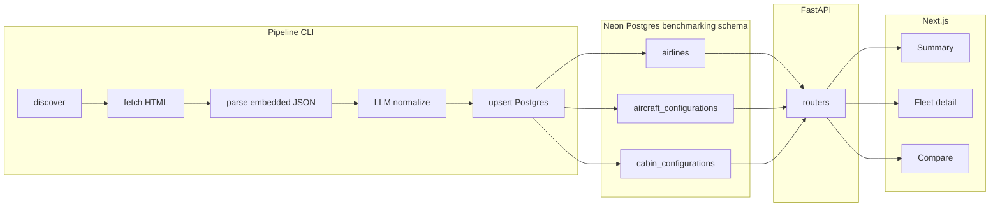
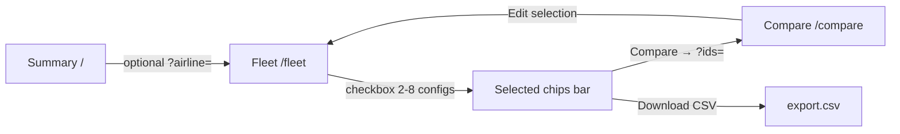

# Flight Benchmarking — Architecture

## Overview

Monolithic repo with three layers:

1. **Pipeline** (`pipeline/`) — discovers and extracts aircraft hardware features from [AeroLOPA](https://www.aerolopa.com/) for EK, BA, AI via embedded JSON + LLM normalization
2. **Backend** (`backend/`) — FastAPI REST API serving aggregated data from Postgres
3. **Frontend** (`frontend/`) — Next.js + shadcn/ui comparison dashboard

**In scope (Phase 1):** Aircraft hardware features only (pipeline + DB + API + 3 UI views). Cabin-class flight features are deferred.

See [Key design decisions](#key-design-decisions) for rationale behind major choices. Update that section and the [Change log](#change-log) when scope, stack, or architecture changes.

## Monorepo layout

```
flight-benchmarking/
├── backend/
│   ├── app/
│   │   ├── main.py              # FastAPI entry (routes + auth)
│   │   ├── config.py            # env, CORS, edit auth
│   │   ├── auth.py              # single-password edit auth (HMAC session tokens)
│   │   ├── db/                  # SQLAlchemy engine, session, Neon URL normalization
│   │   ├── models/              # ORM models
│   │   └── routers/             # airlines, aircraft, compare, export, aircraft_grouping
│   └── alembic/                 # migrations
├── pipeline/
│   ├── config.py                # target airlines, rate limits
│   ├── discover.py              # list config URLs per airline
│   ├── fetch.py                 # HTTP fetch + HTML storage
│   ├── parse_json.py            # extract embedded Next.js aircraft JSON
│   ├── deck.py                  # dual-deck detection (-m/-u suffixes, parent skip)
│   ├── clean.py                 # pre-LLM payload stripping
│   ├── normalize.py             # deterministic base + LLM deep-merge
│   ├── validate.py              # field-level tolerant LLM validation
│   ├── artifacts.py             # save data/parsed JSON artifacts
│   ├── load.py                  # upsert into Postgres
│   ├── prompts/                 # EPD-style LLM prompt + typed output schema
│   └── run.py                   # CLI orchestrator
├── frontend/                    # Next.js 14+ App Router + shadcn/ui
│   ├── app/
│   │   ├── page.tsx             # View 1: airline summary
│   │   ├── fleet/               # View 2: fleet table + selection/export
│   │   └── compare/             # View 3: side-by-side comparison + edit
│   ├── components/
│   │   ├── ui/                  # shadcn primitives (table, card, badge, dialog, etc.)
│   │   ├── multi-select-filter.tsx
│   │   ├── compare-column-editor.tsx
│   │   └── ...                  # PageHeader, MetricCard, AppShell, etc.
│   ├── lib/
│   │   ├── api.ts               # typed fetch client + auth + CSV download
│   │   ├── use-edit-auth.ts     # compare edit session hook
│   │   ├── compare-fields.ts    # field types/labels (mirrors shared/compare_fields.py)
│   │   ├── constants.ts         # MIN/MAX compare limits
│   │   └── design-tokens.ts     # table density, cabin keys, airline labels
│   └── components.json          # shadcn config
├── tests/                       # API + compare/export/update integration tests
├── scripts/                     # reset_schema, deck migration, verification helpers
├── docs/
│   ├── architecture.md
│   └── deployment.md
├── shared/
│   ├── schemas.py               # Pydantic models (pipeline + backend contract)
│   ├── compare_fields.py        # compare/edit field metadata + coercion
│   └── constants.py             # MAX_COMPARE_CONFIGS (8)
├── output.py                    # kept as reference example
├── pyproject.toml               # Poetry deps for backend + pipeline
├── .env.example
└── readme.md
```

Deploy targets: `frontend/` → Vercel, backend API → Railway (root [`railway.toml`](../railway.toml) + [`nixpacks.toml`](../nixpacks.toml)).

## Data flow



**Incremental updates:** Store `last_updated` (from AeroLOPA JSON) and `fetched_at` per config. By default, re-runs extract and upsert all discovered configs (refreshing existing DB rows). Use `--skip-existing` to skip fetch/parse/LLM for configs already in the database and only backfill net-new `svg_id`s.

## Data pipeline

| Stage | Module | Description |
|-------|--------|-------------|
| Discover | `pipeline/discover.py` | List config URLs per airline from `/ek`, `/ba`, `/ai` |
| Fetch | `pipeline/fetch.py` | Download HTML to `data/raw/{svg_id}.html` |
| Parse | `pipeline/parse_json.py` | Extract embedded Next.js aircraft JSON |
| Normalize | `pipeline/normalize.py` | Deterministic base + Langchain/Gemini deep-merge |
| Load | `pipeline/load.py` | Upsert into `benchmarking.*` tables |
| Artifacts | `pipeline/artifacts.py` | Save raw/normalized JSON to `data/parsed/` |
| Deck | `pipeline/deck.py` | Detect `-m`/`-u` deck pages; skip dual-deck parent overview rows at load |

### Dual-deck aircraft

AeroLOPA dual-deck types (e.g. A380) expose a parent overview page plus per-deck pages (`ek-388j-m`, `ek-388j-u`).

| Layer | Behaviour |
|-------|-----------|
| Pipeline | `is_dual_deck_parent()` skips upserting the parent overview; deck pages (`-m`, `-u`) are canonical DB rows with `parent_svg_id`, `deck`, `deck_state`, and optional `decks` JSONB |
| API list/detail | `aircraft_grouping.py` merges rows sharing a `parent_svg_id` into one logical config (`svg_id` = group id); seat counts and cabins are merged across decks |
| Fleet UI | Combined row shows **Dual deck** badge; `source_url` points at parent group URL when merged |
| Compare/edit | Operates on grouped `svg_id`; cabin updates route to the deck row with the most seats for that cabin |

### Pipeline troubleshooting

**Run summary counts:**

| Log term | Meaning |
|----------|---------|
| `updated` | Config extracted and upserted to Postgres |
| `skipped (already loaded)` | Config already in DB and skipped via `--skip-existing` |
| `skipped_parent` | Dual-deck parent overview — artifacts saved, DB load skipped (deck pages are canonical) |
| `errors` | Fetch, parse, or unhandled failure |

Per-config lines look like: `INFO ek-359g: updated (source=llm)` or `INFO ek-359u: skipped (already loaded)`.

**Flags:**

- `--limit N` — process only the first N discovered configs (useful for dev)
- `--skip-existing` — skip fetch/parse/normalize for configs already in the database; only process net-new `svg_id`s
- `--force` — re-fetch HTML from AeroLOPA (bypass `data/raw/` cache); overrides `--skip-existing`

**Artifact directories:**

| Path | Content |
|------|---------|
| `data/raw/{svg_id}.html` | Cached AeroLOPA HTML |
| `data/parsed/{svg_id}.raw.json` | Extracted embedded aircraft JSON (full parse, includes per-seat map) |
| `data/parsed/{svg_id}.cleaned.json` | Pre-LLM payload: seats/URLs/assets stripped via `pipeline/clean.py` |
| `data/parsed/{svg_id}.normalized.json` | Final schema after normalize (deterministic + optional LLM merge) |
| `data/parsed/{svg_id}.llm.json` | Raw parsed JSON from LLM (when source=llm) |
| `data/parsed/{svg_id}.meta.json` | `{ "source", "normalized_at", "last_updated", "dropped_fields" }` |

If DB rows look sparse, inspect `data/parsed/*.normalized.json` first. Normalization builds a deterministic base from raw JSON, then deep-merges LLM output (non-null overlay values only). Field-level tolerant validation drops invalid LLM fields back to the deterministic base rather than failing the whole record. If LLM fails entirely, deterministic output is used.

### Discovery (`pipeline/discover.py`)

- For each slug (`ek`, `ba`, `ai`): `GET https://www.aerolopa.com/{slug}`
- Extract config URLs from `href="/{slug}-..."` links; for dual-deck types, also parse `aircraft_code` from embedded RSC JSON to catch `-m`/`-u` deck pages
- Persist discovered URLs in `pipeline_runs` / `source_pages` tracking table

### Fetch (`pipeline/fetch.py`)

- Polite HTTP client (User-Agent, small delay between requests)
- Save raw HTML to `data/raw/{svg_id}.html` for audit/replay
- Record HTTP status and fetch timestamp

### JSON parse (`pipeline/parse_json.py`)

- Extract `self.__next_f.push(...)` payloads from HTML
- Collect candidate aircraft objects and return the richest (most cabin fields)
- Return structured dict; fail gracefully with logged error if parse fails

### LLM normalize (`pipeline/normalize.py`, `pipeline/clean.py`, `pipeline/prompts/`, `pipeline/validate.py`)

- Build deterministic base from **full** raw JSON (IFE/WiFi split, USB, recline, seat ratings from `seats` map, etc.)
- **Pre-LLM clean** (`pipeline/clean.py`): strip `seats`, image URLs, and asset noise before prompt injection (~168KB → ~3KB for typical configs)
- EPD-style structured prompt in `pipeline/prompts/aircraft_hardware_prompt.py` (role, context, field definitions, constraints, full `ek-359g` example from `output.py`)
- **Typed output schema** in `pipeline/prompts/schema_format.py` — generated from `shared/schemas.py` Pydantic models (EPD-style `<string>`, `<integer>`, nested objects)
- Langchain/Gemini deep-merges over base — LLM cannot wipe deterministic fields with nulls
- Field-level tolerant validation in `pipeline/validate.py` — invalid LLM fields fall back to base values; `dropped_fields` recorded in meta
- Configurable model via env (`LLM_MODEL=gemini-2.5-pro`)

### Load (`pipeline/load.py`)

- Upsert airlines, aircraft configurations, cabin rows
- Use `svg_id` as natural key (e.g. `ek-359g`)

### CLI (`pipeline/run.py`)

```bash
# From repo root (with .env configured)
poetry install
python -m pipeline.run --airlines ek,ba,ai
python -m pipeline.run --airlines ek --limit 5 --skip-existing   # backfill only net-new configs
python -m pipeline.run --airlines ek --limit 5 --force           # dev: re-fetch from AeroLOPA
```

## Database schema

Schema: `benchmarking` in Neon Postgres (database name from your Neon project, e.g. `neondb`).

| Table | Purpose | Key columns |
|-------|---------|-------------|
| `airlines` | Airline metadata | `id` UUID PK, `slug`, `iata_code`, `name` |
| `aircraft_configurations` | Aircraft-level features | `id` UUID PK, `svg_id` unique, `airline_id` UUID FK, `source_url`, `aircraft_type`, `configuration`, dual-deck cols (`is_dual_deck`, `deck`, `parent_svg_id`, `deck_state`, `decks` JSONB), `seat_counts` JSONB, `wifi` JSONB, `ife_*`, `last_updated`, `fetched_at`, `updated_at` |
| `cabin_configurations` | Cabin-level features | `id` UUID PK, `aircraft_id` UUID FK, `deck`, `cabin_key` (unique per aircraft+deck), pitch/width/recline, USB, power, `layout`, seat fields |
| `pipeline_runs` | Audit trail | `id` UUID PK, `started_at`, `airlines`, `configs_discovered`, `configs_updated` |

- All primary keys and foreign keys use UUID (`uuid4` on insert)
- `source_url` stores the AeroLOPA page URL (`https://www.aerolopa.com/{svg_id}`), set at pipeline load
- `svg_id` remains the business/natural key for API routes and compare UI
- Schema reset after UUID migration: `poetry run python scripts/reset_schema.py` then re-run pipeline

## API

**Dependencies:** FastAPI, SQLAlchemy 2.x, asyncpg/psycopg, Pydantic v2, uvicorn

Base URL: `http://localhost:8000`

| Endpoint | View | Returns |
|----------|------|---------|
| `GET /health` | — | Health check |
| `POST /api/v1/auth/login` | Compare edit | `{ token }` — HMAC-signed session token (8h TTL); 503 if `EDIT_PASSWORD` unset |
| `GET /api/v1/auth/me` | Compare edit | `{ authenticated }` — validates Bearer token; returns `authenticated: true` when edit auth disabled |
| `POST /api/v1/auth/logout` | Compare edit | No-op server-side; client clears token |
| `GET /api/v1/airlines/summary` | Summary | Per-airline: fleet count, total seats, aircraft type breakdown, last pipeline update |
| `GET /api/v1/aircraft` | Fleet detail | Grouped list (dual-deck merged); query params: `airline` and `aircraft_type` (comma-separated multi-value), `search`, `has_premium_economy=true`, `offset`, `limit` |
| `GET /api/v1/aircraft/{svg_id}` | Detail drill-down | Full grouped aircraft + cabins (resolves `parent_svg_id` groups) |
| `GET /api/v1/compare?ids=ek-359g,ba-19a&cabin=business` | Compare | `CompareResponse`: `columns` + `rows` (pivoted feature matrix with `field_key`, `scope`, raw `values`); 2–8 configs |
| `PATCH /api/v1/aircraft/{svg_id}` | Compare edit | Partial update of compare-visible fields; requires `Authorization: Bearer <token>` when `EDIT_PASSWORD` set; returns full `AircraftConfiguration` |
| `GET /api/v1/export.csv?ids=ek-359g,ba-19a` | Fleet export | CSV download — one row per cabin class per config (aircraft + cabin fields from `shared/compare_fields.py`) |

**Compare response** (`shared/schemas.py`):

| Field | Type | Purpose |
|-------|------|---------|
| `columns` | `CompareConfigColumn[]` | Per-config header metadata: `svg_id`, `airline_slug`, `airline_name`, `aircraft_type_displayed`, `aircraft_code_displayed`, `configuration`, `source_url` |
| `rows` | `CompareRow[]` | Pivoted features: `feature`, `field_key`, `scope`, `category`, `values` keyed by `svg_id` |

**Performance choices:**

- Summary endpoint uses SQL aggregations (not N+1)
- Fleet list groups dual-deck rows in Python after a single join query (no N+1 per deck)
- Compare endpoint returns a pre-pivoted structure (`rows`: feature name → values per column) plus `columns` metadata for readable table headers — no client-side reshape or extra detail fetches
- Response schemas are slim DTOs (no raw HTML, no seat-level data in list views)
- CORS configured for local dev, production Vercel origin, and `*.vercel.app` previews via `CORS_ORIGIN_REGEX`

## Frontend

**Stack:** Next.js App Router, TypeScript, Tailwind CSS (via shadcn), shadcn/ui component library, TanStack Table for sortable/filterable data grids.

**Design system (Linear light + LCM Hub layout):**

- **Color palette:** Linear light theme in `frontend/app/globals.css` — canvas `#f7f8f8`, panels `#ffffff`, accent `#5e6ad2`, hairline borders `rgba(0,0,0,0.08)`. Semantic label colors (`--label-red`, `--label-blue`, etc.) for airline badges.
- **Layout inspiration:** [LCM Hub](https://www.lcmhub.com) — section eyebrows, metric-first dashboards, card-contained data panels, consistent page template across views.
- **Typography:** Inter (UI) + Geist Mono (config IDs); compact `text-sm` base, `text-xs` tables.
- **Tokens:** `frontend/lib/design-tokens.ts` — table density classes, control widths, cabin keys, airline label mappings.
- **Core shadcn components:** `table`, `card`, `badge`, `button`, `select`, `input`, `checkbox`, `tabs`, `separator`, `skeleton`, `tooltip`, `dialog`
- **App-level composites:** `PageHeader`, `MetricCard`, `SectionCard`, `EmptyState`, `LoadingState`, `TableToolbar`, `AirlineBadge`, `MultiSelectFilter`, `CompareValueCell` / `CompareFieldInput`
- **Page template:** `PageHeader` → optional `MetricCard` grid → `SectionCard` with edge-to-edge table; shared empty/loading states
- **Layout shell:** `AppShell` with shadcn `Tabs` (line variant) for Summary / Fleet / Compare navigation

### View 1 — Airline summary (`/`)

- `PageHeader` + `MetricCard` grid + `SectionCard` with airline `Table`
- Columns: Airline, Configurations, Aircraft Types, Last Updated (dates formatted `en-GB`, e.g. `30 Jun 2026`)
- Click airline → navigate to View 2 with airline filter pre-applied

### Cross-airline comparison flow

Fleet is the **primary selection surface**; Compare shows side-by-side results and supports **column-scoped batch editing** (one config per save).



- **URL state:** selection is synced to `?ids=` on Fleet and Compare (e.g. `/fleet?ids=ek-359g,ba-19a&airline=all`)
- **Cross-airline discovery:** use airline filter **All airlines** plus aircraft type filter or search (e.g. `A380`) to find like-for-like configs across carriers
- **Limits:** 2–8 configs (`MAX_COMPARE_CONFIGS` in `shared/constants.py`; enforced in Fleet UI and compare API)

### View 2 — Fleet detail (`/fleet`)

- `PageHeader` with `TableToolbar` filters in actions slot:
  - **Airline** — `MultiSelectFilter` from `GET /api/v1/airlines/summary` (empty = all airlines; comma-separated slugs in API)
  - **Aircraft type** — `MultiSelectFilter` over union of summary `aircraft_types`
  - **Premium economy** — checkbox → `has_premium_economy=true` (configs with W seats > 0)
  - **Search** — free text against group `svg_id`, code, type, and seat layout
- Hint when exactly one airline is selected: prompt user to clear or multi-select for cross-carrier comparison
- `SectionCard` with compact `Table` of aircraft configurations (dual-deck rows merged; **Dual deck** badge when applicable)
- Columns: checkbox, Airline, Aircraft Type, Config ID, Seat Layout, Seats, Ref URL (link to AeroLOPA `source_url`)
- `Checkbox` row selection (max 8) with **select all visible** header checkbox → **selected configs bar** above the table:
  - Removable chips: airline badge + aircraft type + config code
  - Counter (`N selected`), **Download CSV** (exports selected ids via `GET /api/v1/export.csv`), and **Compare** button (enabled at 2+)
  - Chip metadata cached in client state so labels persist when filters hide selected rows

### View 3 — Compare (`/compare`)

- Requires `?ids=` with 2–8 comma-separated `svg_id`s (typically navigated from Fleet)
- `PageHeader` with **Sign in to edit** / **Sign out**, **Edit selection** link (back to `/fleet?ids=...`), and cabin `Tabs` (First / Business / Premium Economy / Economy)
- **Edit auth:** when backend `EDIT_PASSWORD` is set, user signs in via password dialog; token stored in `sessionStorage` and sent as `Authorization: Bearer` on `PATCH`; when unset (local dev), edits are open without login
- `SectionCard` compare `Table`: rows = features; columns = selected configs (wider min-width for up to 8 columns)
- Column headers use `CompareResponse.columns` — airline badge, aircraft type, config code, layout, AeroLOPA link, **Edit / Save / Cancel** for column edit mode
- **Column edit mode:** click **Edit** on a column header or any value cell in that column (requires auth when configured); all compare-visible fields in the column become typed inputs (`CompareFieldInput`); **Save** sends one `PATCH` with dirty fields only; **Cancel** or `Escape` discards pending changes
- Highlight differences with `bg-muted/60` and outline `Badge` (view mode)
- Empty state (`< 2` ids): `PageHeader` + `EmptyState` directing user to Fleet

**API integration:** `NEXT_PUBLIC_API_URL` env var; server components for summary initial data; client components for fleet filters, compare, and edit flows. Use shadcn `Skeleton` for loading states.

## Local development

**Database (Neon):** Copy the **Pooled connection** string from the [Neon console](https://console.neon.tech) into `.env` as `DATABASE_URL`. The app auto-converts `postgres://` URLs to the psycopg driver and adds `sslmode=require` for Neon hosts. URL-encode special characters in the password (e.g. `:` → `%3A`). After first setup or schema changes, run `poetry run python scripts/reset_schema.py`.

```bash
# 1. Environment
cp .env.example .env
# Edit DATABASE_URL (Neon pooled connection string), optional GOOGLE_API_KEY

# 2. Python deps + migrations
poetry install
cd backend && poetry run alembic upgrade head

# 3. Run pipeline (populates DB)
python -m pipeline.run --airlines ek,ba,ai

# 4. Backend
poetry run uvicorn backend.app.main:app --reload --port 8000

# 5. Frontend
cd frontend && npm install && npm run dev

# 6. Tests (requires DATABASE_URL)
poetry run pytest tests/
```

## Deployment

| Component | Target | Config |
|-----------|--------|--------|
| Frontend | Vercel | Root directory `frontend`, set `NEXT_PUBLIC_API_URL` |
| Backend | Railway | [`railway.toml`](../railway.toml), [`nixpacks.toml`](../nixpacks.toml); set `DATABASE_URL`, `CORS_ORIGINS`, `CORS_ORIGIN_REGEX`, `EDIT_PASSWORD`, `SESSION_SECRET` |

Step-by-step guide: [deployment.md](./deployment.md).

Secrets documented in [`.env.example`](../.env.example): `DATABASE_URL`, `DB_SCHEMA`, `GOOGLE_API_KEY`, `LLM_MODEL`, `CORS_ORIGINS`, `CORS_ORIGIN_REGEX`, `EDIT_PASSWORD`, `SESSION_SECRET`, `NEXT_PUBLIC_API_URL`.

## Environment variables

| Variable | Used by | Purpose |
|----------|---------|---------|
| `DATABASE_URL` | Pipeline, backend | Neon pooled Postgres connection (auto-normalized to `postgresql+psycopg`) |
| `DB_SCHEMA` | Backend | Postgres schema name (default `benchmarking`) |
| `GOOGLE_API_KEY` | Pipeline | Gemini API key for LLM normalization (optional — falls back to deterministic) |
| `LLM_MODEL` | Pipeline | Gemini model id (default `gemini-2.5-pro`) |
| `CORS_ORIGINS` | Backend | Comma-separated allowed frontend origins |
| `CORS_ORIGIN_REGEX` | Backend | Regex for Vercel preview domains (e.g. `https://.*\.vercel\.app`) |
| `EDIT_PASSWORD` | Backend | Shared password for compare edit; when empty, PATCH is open (local dev) |
| `SESSION_SECRET` | Backend | HMAC signing key for edit session tokens; falls back to hash of `EDIT_PASSWORD` |
| `NEXT_PUBLIC_API_URL` | Frontend | Backend base URL baked at Vercel build time |

See [`.env.example`](../.env.example).

## Implementation status

| Area | Status |
|------|--------|
| Shared Pydantic models (`shared/schemas.py`) | Done |
| Shared compare field metadata (`shared/compare_fields.py`) | Done |
| DB schema + Alembic migrations (incl. dual-deck columns) | Done |
| Pipeline discover + fetch | Done |
| Pipeline parse + normalize + dual-deck handling | Done |
| Pipeline load + CLI | Done |
| FastAPI backend (summary, fleet, compare, export, auth) | Done |
| Dual-deck API grouping (`aircraft_grouping.py`) | Done |
| Next.js frontend (3 views + multi-select filters + CSV export) | Done |
| Compare edit auth (backend + frontend) | Done |
| Integration tests (`tests/`) | Done |
| Docs + deploy configs | Done |

**Build sequence (recommended order):**

1. Shared schemas — Pydantic models from `output.py`
2. DB + migrations — tables and seed from pipeline
3. Pipeline — discover → fetch → parse → normalize → load (validate with `ek-359g` first)
4. API — endpoints against real data
5. Frontend — shadcn/ui setup + three views wired to API
6. Docs + deploy configs — architecture.md, `.env.example`, Vercel/Railway files

## Open items

- **Gemini API key** — provide `GOOGLE_API_KEY` locally for LLM normalization
- **Air India slug** — verify AeroLOPA uses `ai` during discovery; adjust config if different
- **Production edit auth** — set `EDIT_PASSWORD` and `SESSION_SECRET` on Railway before enabling compare edits in production

## Key design decisions

Track significant architectural choices here. When a decision is reversed, mark the old entry **Superseded** and add a new row — do not delete history.

| ID | Decision | Rationale | Alternatives considered | Date |
|----|----------|-----------|-------------------------|------|
| KD-001 | **Monolithic repo** — pipeline, backend, frontend, and shared schemas in one repository | Simpler local dev, shared Pydantic models, single PR workflow for Phase 1 | Separate repos per service; polyrepo with published schema package | 2026-06-29 |
| KD-002 | **Phase 1 scope: aircraft hardware only** — defer readme section [2] cabin-class *flight* features (check-in, baggage, etc.) | Unblocks end-to-end pipeline + comparison UI on a single data source (AeroLOPA) before adding second source and schema | Build both sections in parallel | 2026-06-29 |
| KD-003 | **Target airlines:** `ek`, `ba`, `ai` on AeroLOPA | Core benchmarking set for Emirates competitive analysis | Broader airline list in Phase 1 | 2026-06-29 |
| KD-004 | **Parse embedded Next.js JSON first; LLM only for normalization** — not LLM-on-raw-HTML as primary path | Deterministic extraction from `self.__next_f.push(...)` payloads is cheaper, faster, and more reproducible; LLM maps irregular fields into [`output.py`](../output.py) shape | Full HTML → LLM extraction; rules-only mapping without LLM | 2026-06-29 |
| KD-005 | **Gemini via Langchain** — default `gemini-2.5-pro`, swappable via `LLM_MODEL` | Matches readme requirement; Langchain gives model swap without code changes | Direct Google SDK only; other providers in Phase 1 | 2026-06-29 |
| KD-006 | **`svg_id` as natural key** (e.g. `ek-359g`) for aircraft configurations | Stable AeroLOPA identifier; used in URLs, raw HTML paths, and compare UI | Composite key (airline + aircraft_type + config code) | 2026-06-29 |
| KD-007 | **Postgres `benchmarking` schema** on Neon cloud Postgres | Managed Postgres with SSL; isolates tables via schema namespace; same DB for local dev and Railway deploy | Local `emirates` database; SQLite for dev | 2026-06-29 (updated 2026-06-30) |
| KD-008 | **JSONB for nested aircraft fields** — `seat_counts`, `wifi`, `seat_rating_summary` | Avoids wide sparse tables; matches document-shaped source data | Fully normalized child tables for every nested object | 2026-06-29 |
| KD-009 | **Incremental pipeline** — `--skip-existing` skips extraction for configs already in DB; default always upserts after extraction | Reduces HTTP load, LLM cost, and re-run time when backfilling net-new configs | Always full re-fetch; cron-only freshness | 2026-06-29 |
| KD-010 | **Manual CLI pipeline** (`python -m pipeline.run`) for Phase 1 | No scheduler/queue infra until refresh cadence is defined | Scheduled job (Railway cron, Airflow) in Phase 1 | 2026-06-29 |
| KD-011 | **Raw HTML audit trail** at `data/raw/{svg_id}.html` | Replay and debug parse/normalize without re-scraping; supports future LLM-on-HTML fallback | Fetch-only, no local cache | 2026-06-29 |
| KD-012 | **Shared schemas** in [`shared/schemas.py`](../shared/schemas.py) imported by pipeline and backend | Single validation contract from extraction through API | Duplicate Pydantic models per layer | 2026-06-29 |
| KD-013 | **FastAPI compare endpoint returns pre-pivoted rows** (`CompareResponse`: `columns` + `rows`) | Frontend renders table headers from `columns` and feature cells from `rows`; no client-side pivot or per-column detail fetches | Client-side pivot; GraphQL field selection | 2026-06-29 (updated 2026-06-30) |
| KD-017 | **Fleet-primary cross-airline comparison** — selection on Fleet via `?ids=`; Compare supports per-config column editing with batch save; optional password auth gates PATCH | Keeps one selection affordance; URL-shared state survives refresh; manual corrections via single PATCH per save; production edits protected by `EDIT_PASSWORD` | Config picker on Compare; per-cell immediate save; open PATCH in production | 2026-06-30 (updated 2026-06-30) |
| KD-018 | **Dual-deck grouping at API layer** — deck pages (`-m`/`-u`) stored separately; list/detail/compare merge by `parent_svg_id` | Matches AeroLOPA page model; accurate per-deck cabin data; single logical row in Fleet/Compare | Store only merged rows in DB; client-side deck merge | 2026-06-30 |
| KD-019 | **Single-password edit auth** — `EDIT_PASSWORD` + HMAC session tokens (`SESSION_SECRET` or derived secret); 8h TTL | Lightweight protection for manual compare corrections without full user management | OAuth; API keys per user; no auth | 2026-06-30 |
| KD-020 | **Fleet CSV export** — `GET /api/v1/export.csv` for selected `svg_id`s; one row per cabin class | Offline analysis and stakeholder sharing without custom scripts | Client-side JSON export only | 2026-06-30 |
| KD-021 | **Compare limit raised to 8 configs** — `MAX_COMPARE_CONFIGS` shared constant | Supports wider cross-carrier benchmarking (e.g. multiple A380 configs) | Fixed 4-config cap | 2026-06-30 |
| KD-022 | **Multi-select fleet filters** — comma-separated `airline` / `aircraft_type` query params + premium economy toggle | Cross-carrier discovery without repeated filter changes | Single-select only | 2026-06-30 |
| KD-014 | **Slim API DTOs** — no raw HTML or seat-level data in list/summary endpoints | Keeps fleet and summary views fast; detail endpoint for drill-down | Return full source payload everywhere | 2026-06-29 |
| KD-015 | **Next.js App Router + shadcn/ui** — compact light theme, TanStack Table | Standardised design system per readme; data-dense tables inspired by Eleken/LCM Hub | MUI, Ant Design, plain Tailwind | 2026-06-29 |
| KD-016 | **Deploy split:** frontend → Vercel, backend → Railway | Matches readme deployment targets; fits static/SSR frontend + long-running API | Single host; containerise both on Railway | 2026-06-29 |

## Change log

Record notable architecture, schema, API, and deployment changes here (newest first). Link KD-* IDs when a change reflects a new or updated design decision.

| Date | Change |
|------|--------|
| 2026-06-30 | Edit auth: `POST/GET /api/v1/auth/*`, `backend/app/auth.py`, Compare **Sign in to edit** dialog, Bearer token on PATCH; `EDIT_PASSWORD` + `SESSION_SECRET` env vars — KD-017, KD-019 |
| 2026-06-30 | Fleet multi-select filters (`MultiSelectFilter`), premium economy checkbox, select-all-visible, CSV download (`GET /api/v1/export.csv`, `export.py`) — KD-020, KD-022 |
| 2026-06-30 | Dual-deck pipeline + API grouping: `pipeline/deck.py`, `aircraft_grouping.py`, DB deck columns, Fleet **Dual deck** badge — KD-018 |
| 2026-06-30 | Compare supports up to 8 configs (`shared/constants.py`); wider compare table layout — KD-021 |
| 2026-06-30 | Compare column edit mode: batch `PATCH /api/v1/aircraft/{svg_id}` for manual config corrections; `CompareRow` extended with `field_key`, `scope`, raw `values`; shared field metadata in `shared/compare_fields.py` — KD-017 |
| 2026-06-30 | Cross-airline comparison UX: Fleet dynamic airline/type filters, URL-synced `?ids=` selection, removable chips bar; Compare readable column headers + Edit selection; API `CompareResponse` (`columns` + `rows`); aircraft list `search` matches type and layout — KD-013, KD-017 |
| 2026-06-30 | Database: Neon Postgres support — URL normalization (`postgres://` → psycopg), SSL for `*.neon.tech`, pooled connection pool limits; `.env.example` updated |
| 2026-06-29 | Pipeline CLI: `--skip-existing` skips extraction for configs already in DB; default re-runs always upsert (no DB write skip on matching `last_updated`); `--force` re-fetches HTML only |
| 2026-06-29 | Pipeline data quality: enriched deterministic normalize, LLM deep-merge over base, `data/parsed/` artifacts, clearer updated/unchanged logging, `--force` re-writes DB |
| 2026-06-29 | Merged Phase 1 development plan into `architecture.md` — pipeline stage detail, frontend view specs, DB column reference, implementation status |
| 2026-06-29 | Phase 1 scaffolding: `shared/schemas.py`, Alembic migrations, FastAPI backend (summary/fleet/detail/compare), Next.js frontend (3 views), `.env.example`, Vercel/Railway configs |
| 2026-06-29 | Initial architecture doc — monorepo layout, data flow diagram, local dev and deployment notes |

**How to update:** Add a row at the top when you change schema, API contracts, pipeline behaviour, deploy targets, or Phase scope. For substantive choices, add or update a row in [Key design decisions](#key-design-decisions) first, then reference the KD ID in the changelog entry.
